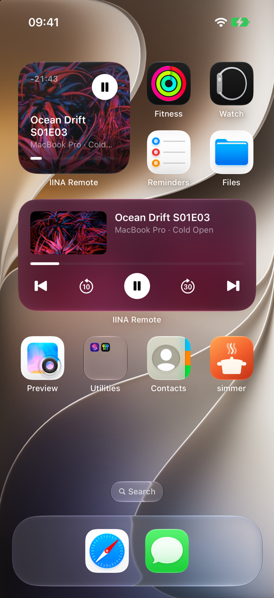

# IINA Remote

Control [IINA](https://iina.io) from your iPhone, Apple Watch or any browser on the same network:
play, pause, seek, volume, speed, subtitle and audio tracks, delays, playlist, chapters and recent files.

<p>
  
  
  
</p>

## Install

**1. IINA plugin (required).** In IINA → Settings → Plugins, install from GitHub with
`https://github.com/avr6ude/iina-remote` (IINA then offers updates), or download the `.iinaplgz` from
[Releases](../../releases) and double-click it. Enable **Remote**.

**2. iPhone app.**

<a href="https://apps.apple.com/app/id6825027883"></a>

Open a video in IINA and launch the app. It finds every IINA window on your network by itself;
with more than one, tap the title to switch. Leave the app while something plays to get a Live Activity
on the lock screen; there's also a Now Playing widget, Siri ("Pause IINA Remote", "Skip forward in
IINA Remote", "Next episode in IINA Remote") and an Apple Watch app.

**No app?** In IINA choose **Plugin → Show Remote QR Code** and scan the code with any phone.
On a computer the page also takes Space (play/pause), ←/→ (seek), ↑/↓ (volume) and M (mute).


## Development

```sh
ln -s "$PWD" ~/Library/Application\ Support/com.colliderli.iina/plugins/com.avrdude.iina-remote.iinaplugin-dev
open ios/IINARemote.xcodeproj
```

Each IINA window serves a WebSocket on port 8766 and up, advertised over Bonjour as
`_iina-remote._tcp`; the browser remote is served on port 8765. There is no authentication:
anyone on your network can control playback.
